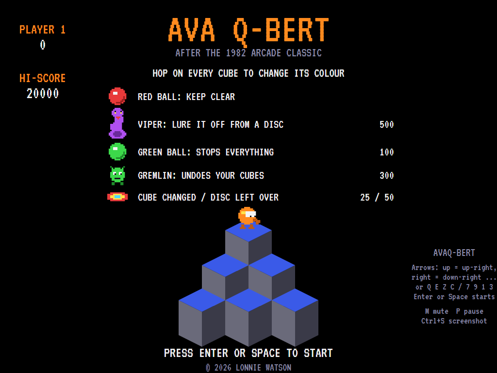
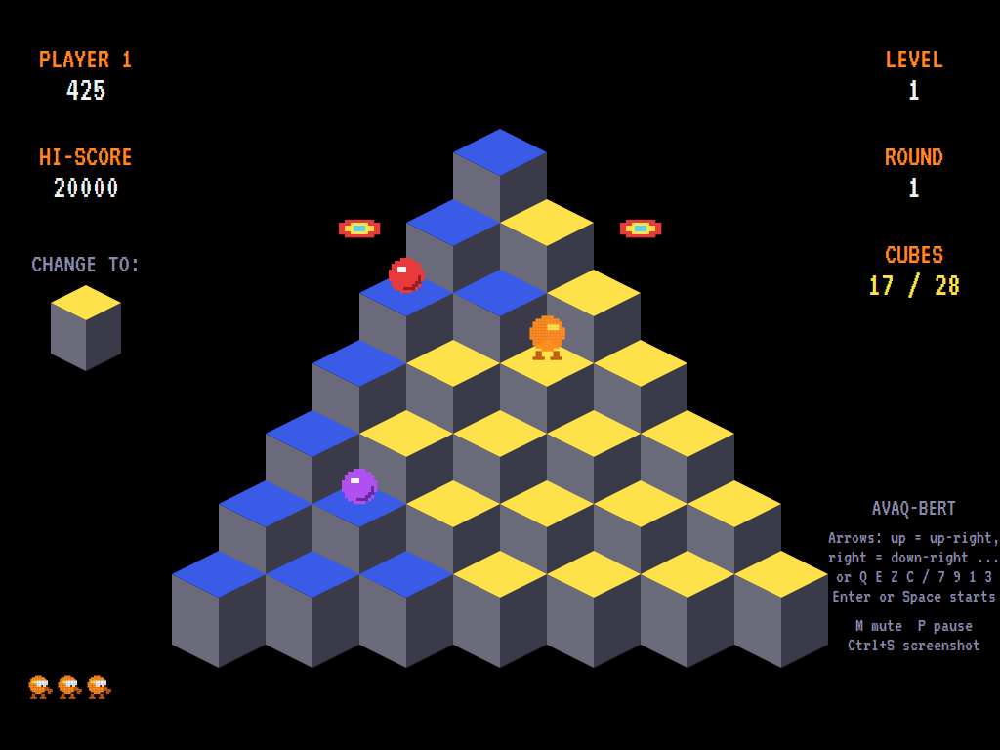
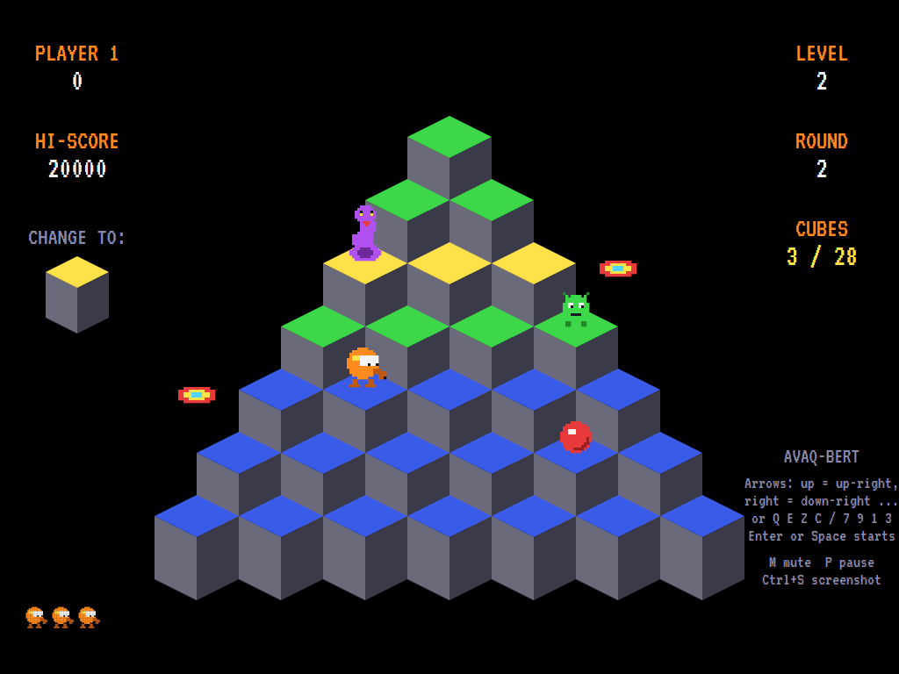
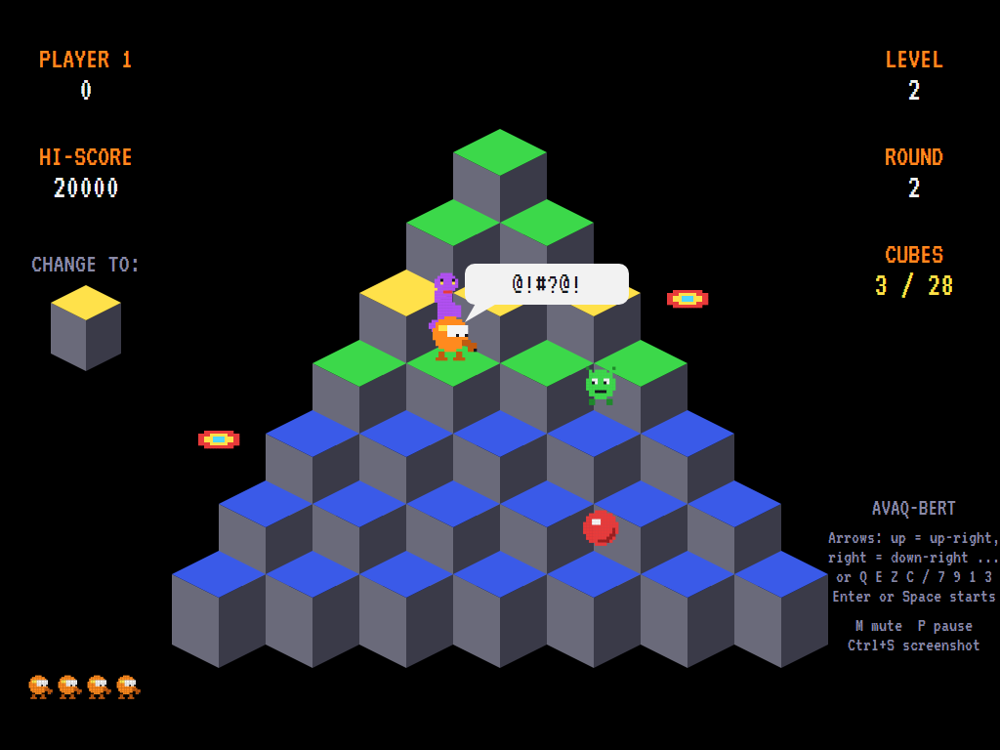
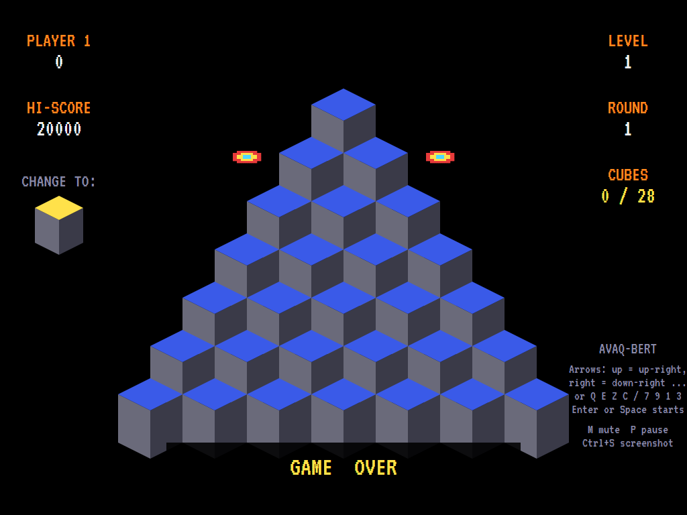
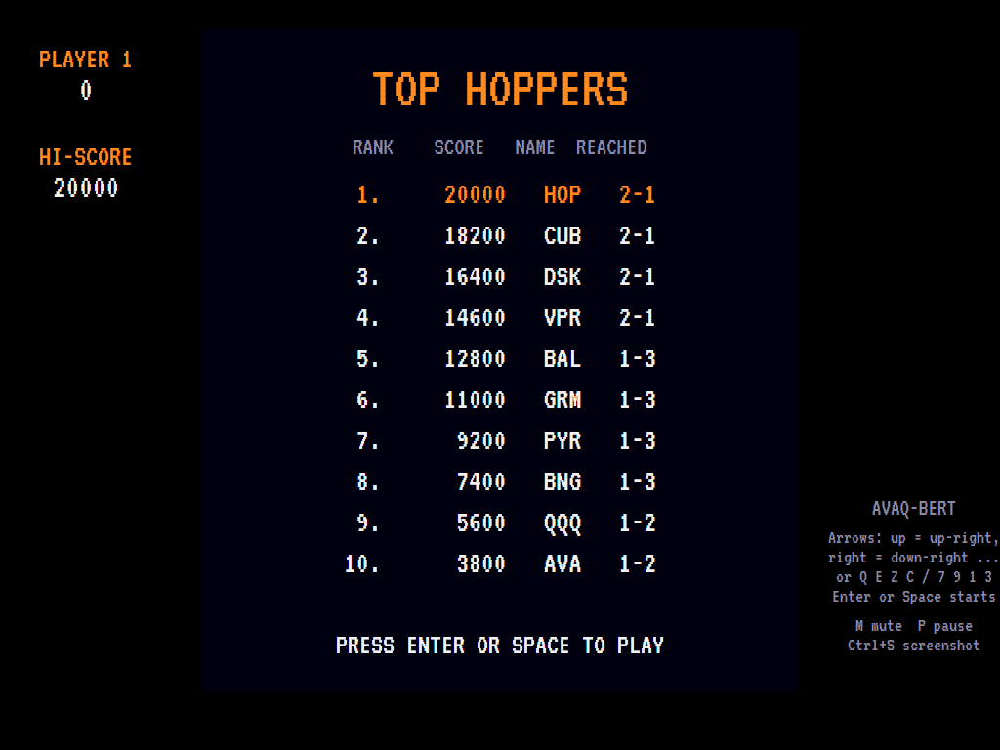

# AVAQ-Bert

[](https://github.com/Harlock123/AVAQ-Bert/actions/workflows/build.yml)

A cube-hopping game in the style of Gottlieb's 1982 arcade game **Q\*bert**, built with .NET 10 and
Avalonia UI. Hop diagonally around a pyramid of 28 cubes, changing the colour of every top. Keep clear
of the bouncing balls, outwit the viper, and escape on the spinning discs. The hero and everything
after them are this game's own characters.

## Features

- **The pyramid**: seven rows of isometric cubes. Every hop is diagonal: up or down the pyramid, left
  or right. Hop off the edge where there's no disc and you fall.
- **Colour rules** that get trickier with each level:
  - **Level 1**: one hop turns a cube.
  - **Level 2**: two hops, through a middle colour.
  - **Level 3**: one hop turns it, but another turns it back.
  - **Level 4 and on**: two hops to finish, and another knocks it back a step.
  
  A "change to" cube beside the pyramid shows the colour to aim for. Four rounds make a level, each
  in new colours.
- **The others**:
  - **Red balls** drop in and bounce down the pyramid and off the bottom.
  - The **purple ball** bounces down and hatches into the **viper**, which hunts you up and down.
  - The **green ball** stops everything for a few seconds if you catch it.
  - The **gremlin** hops down turning your cubes back, and is worth catching.
- **Discs**: two spinning discs beside the pyramid each round. Hop onto one and it carries you to the
  top. If the viper is close behind, it follows you off the edge, for 500. Discs left over at the end of
  a round are worth 50 each.
- **Caught**: the hero lets out a cursing "@!#?@!" and everything clears away. You carry on from where
  you were.
- **Sound**: no music while you play, as on the arcade, just the hops, the boings and the garbled
  cursing, plus an original title tune and fanfares, all mixed by OpenAL.
- **Attract mode**: leave the title alone for 15 seconds and a computer player plays a demonstration.
  It marks every cube something dangerous could land on next and keeps off them, and it regularly gets
  into level 3.
- **Four lives**, a bonus life at 8,000 and every 14,000 after, and a **top-ten high-score table** with
  arcade-style initials entry. The table records the level and round you reached.
- **Any window size**: the screen scales to fit, letterboxed. **Ctrl+S** saves a screenshot.
- **One self-contained executable** per platform: Windows, macOS and Linux on Intel/AMD and ARM.

The sprites, colours, sounds and tunes are all this game's own.

## Screenshots

| Title screen | A round under way | The viper on the trail |
|:------------:|:-----------------:|:----------------------:|
|  |  |  |
| The others, and what they're worth. | Most of the cubes turned; the discs waiting at the sides. | Level 2: a middle colour on the way, the viper, a red ball and the gremlin. |

| Caught | Game over | The high-score table |
|:------:|:---------:|:--------------------:|
|  |  |  |
| @!#?@! | Out of lives. | The best hoppers. |

The screenshots are made by the tests, which play the game in a real (headless) window; see
[Tests](#tests).

## Download and run

Ready-to-run builds for Windows, macOS and Linux, on both Intel/AMD and ARM, are on the
[Releases page](https://github.com/Harlock123/AVAQ-Bert/releases/tag/latest). **Latest build** is
rebuilt on every push to `main`. Each download is one self-contained executable: no .NET install is
needed.

| Platform | Archive |
|---|---|
| Windows | `AVAQ-Bert-win-x64.zip`, `AVAQ-Bert-win-x86.zip`, `AVAQ-Bert-win-arm64.zip` |
| macOS | `AVAQ-Bert-osx-arm64.tar.gz` (Apple silicon), `AVAQ-Bert-osx-x64.tar.gz` (Intel) |
| Linux | `AVAQ-Bert-linux-x64.tar.gz`, `AVAQ-Bert-linux-arm64.tar.gz`, `AVAQ-Bert-linux-arm.tar.gz` |

```bash
tar -xzf AVAQ-Bert-linux-x64.tar.gz     # or linux-arm64, linux-arm, osx-arm64, osx-x64
./AVAQ-Bert
```

On Windows, unzip and run `AVAQ-Bert.exe`. On macOS, if Gatekeeper refuses to open it, run
`xattr -d com.apple.quarantine AVAQ-Bert` once. Run with `--no-audio` for silence.

**Sound** comes through OpenAL Soft, built in for every platform. In a virtual machine the game
detects it and uses a larger audio buffer, so the sound doesn't break up.

**Gamepads** use SDL2, which is bundled for Windows, macOS and Intel/AMD Linux. ARM Linux builds need it
installed; without it the keyboard still works:

```bash
sudo apt install libsdl2-dev            # Debian / Ubuntu / Raspberry Pi OS
sudo pacman -S --needed sdl2-compat     # Arch / Omarchy
```

## Controls

Every hop is diagonal. Take your pick:

| Input | Up-left | Up-right | Down-left | Down-right |
|-------|:-------:|:--------:|:---------:|:----------:|
| **Arrow keys**, turned a quarter round as on the arcade's diagonal stick | Left | Up | Down | Right |
| **Corner keys** | Q | E | Z | C |
| **Number pad** | 7 | 9 | 1 | 3 |

Hold a direction to keep hopping that way. **WASD** works like the arrow keys.

| Input | Action |
|-------|--------|
| **Enter** / **Space** | Start a game |
| **P** / **Esc** | Pause (Esc again to quit) |
| **M** | Mute |
| **Ctrl+S** / **Cmd+S** | Save a screenshot to the Pictures folder |

**Gamepad**: push the left stick into a corner to hop that way, or use the D-pad (turned like the arrow
keys); **Start** or **A** starts, **Start** pauses, **Back** (while paused) quits.

**Entering initials**: type letters, or dial with **Up**/**Down** and accept with **Space**; **Left** /
**Backspace** go back; **Enter** finishes.

## Scoring

| What | Points |
|---|---:|
| A cube changed | 25 |
| Catching the green ball (and stopping everything) | 100 |
| Catching the gremlin | 300 |
| Luring the viper off the edge | 500 |
| Finishing the pyramid | 1000, plus 250 more each round after the first |
| Each disc not used | 50 |

## Tests

```bash
dotnet test AVAQ-Bert.slnx
```

The engine has no UI and runs in fixed 60 Hz steps, so it plays the same at any frame rate, and a seed
always plays the same game. The tests check:

- the pyramid and its diagonal hops, and each level's colour rule;
- scoring cubes;
- falling off, riding a disc, and luring the viper off;
- the balls (bouncing off, catching, and the curse), the viper hatching and hunting, the green ball's
  freeze, and the gremlin;
- finishing rounds and levels, and bonus lives;
- the title tune, the demonstration's sound, pausing, and every sound and sprite.

A computer player (the attract-mode one) plays whole games in them and must reach the third round.

The screenshot tests draw the real screen in a headless window. To refresh the README's pictures:

```bash
QBERT_SHOTS=$PWD/Images dotnet test tests/AVAQ-Bert.Tests --filter ScreenshotTests
```

## Building

```bash
dotnet build AVAQ-Bert.slnx
dotnet run --project src/AVAQ-Bert
```

Needs the .NET 10 SDK. The sounds are made by `tools/make_sounds.py` (standard-library Python):
`python3 tools/make_sounds.py` rewrites `src/AVAQ-Bert/Sounds`. (The program and its files are named
AVAQ-Bert; the C# namespace is `AVAQBert`, as a namespace can't have a hyphen.)

## Project structure

```
AVAQ-Bert/
├── AVAQ-Bert.slnx
├── src/AVAQ-Bert/
│   ├── Engine/
│   │   ├── GameEngine.cs        # States, scoring and bonus lives
│   │   ├── GameEngine.Play.cs   # Hopping, colours, discs, falling, the balls, the viper, the gremlin,
│   │   │                        # the freeze, and the rounds and levels
│   │   ├── Entities.cs          # The hero and the others
│   │   ├── AttractPilot.cs      # The computer player for the demonstration (and the tests)
│   │   ├── HighScoreTable.cs, InitialsEntry.cs
│   │   ├── InputHandler.cs, ControllerManager.cs  # Keys and an SDL2 gamepad, mapped to diagonal hops
│   │   └── SoundManager.cs      # Effects and tunes through OpenAL
│   ├── Audio/                   # The OpenAL engine (from the author's AVABand)
│   ├── Models/                  # The pyramid, its colour rules and each round's colours, and the pixel art
│   ├── Views/                   # The screen: the isometric pyramid, the hoppers, panels, title and tables
│   └── Sounds/                  # The synthesised effects and tunes
├── tests/AVAQ-Bert.Tests/       # Gameplay and screenshot tests
├── tools/make_sounds.py
└── Images/                      # Screenshots
```

## About and licence

AVAQ-Bert © 2026 Lonnie Watson, under the [MIT License](LICENSE).

*Q\*bert* © 1982 Gottlieb; the name and character belong to their current owner. AVAQ-Bert is an
independent, unofficial game in its style. Its characters, sprites, sounds, tunes and code are its own;
nothing is taken from the arcade machine's program, graphics or sound. It is not affiliated with or
endorsed by any rights holder.

Bundled components keep their own licences: the VT323 font (SIL Open Font License 1.1, by Peter Hull;
`src/AVAQ-Bert/Assets/Fonts/VT323-OFL.txt`), OpenAL Soft (LGPL-2.0-or-later; loaded as a separate
library; `src/AVAQ-Bert/Audio/native/COPYING-openal-soft.txt`), and the MIT-licensed Avalonia,
Silk.NET, NVorbis, NLayer and SDL2-CS (with SDL2 under the zlib licence).
